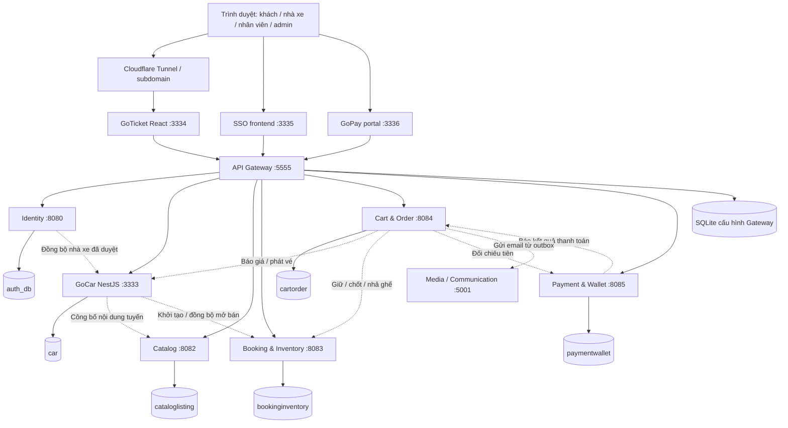
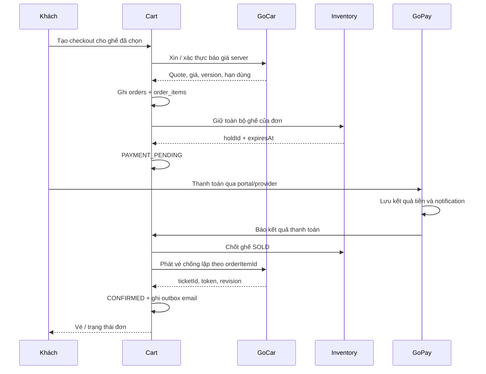
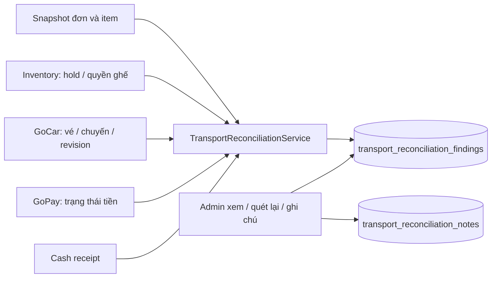

# GoTicket — Kiến trúc, luồng nghiệp vụ và bản đồ database

> Tài liệu hiện trạng ngày **18/10/2026** cho môi trường `/home/DoANLienNganh`.
> Tên hiển thị sản phẩm là **GoTicket**, backend vẫn nằm trong thư mục `car`, database tên `car`, domain dùng thử là `https://gocar.nonnet123.io.vn`.
> Nội dung đối chiếu từ source, cấu hình triển khai và metadata database đang có. Đây là hướng dẫn đọc hệ thống; trạng thái từng bản ghi sẽ thay đổi khi người dùng thao tác.

## Mục lục

1. [Đọc nhanh: cần tìm dữ liệu nào thì vào đâu?](#1-đọc-nhanh-cần-tìm-dữ-liệu-nào-thì-vào-đâu)
2. [Kiến trúc và các service](#2-kiến-trúc-và-các-service)
3. [Danh sách database và cấu hình kết nối](#3-danh-sách-database-và-cấu-hình-kết-nối)
4. [Tuyến đường, chuyến xe, ghế, đơn hàng và vé khác nhau thế nào?](#4-tuyến-đường-chuyến-xe-ghế-đơn-hàng-và-vé-khác-nhau-thế-nào)
5. [Bảng trong từng database](#5-bảng-trong-từng-database)
6. [Các ID nối dữ liệu giữa service](#6-các-id-nối-dữ-liệu-giữa-service)
7. [Các luồng nghiệp vụ chính](#7-các-luồng-nghiệp-vụ-chính)
8. [Trạng thái và quy tắc quan trọng](#8-trạng-thái-và-quy-tắc-quan-trọng)
9. [Admin, đối soát và báo cáo](#9-admin-đối-soát-và-báo-cáo)
10. [Outbox, tiến trình nền và xử lý lại](#10-outbox-tiến-trình-nền-và-xử-lý-lại)
11. [Cách lần theo một đơn bằng SQL chỉ đọc](#11-cách-lần-theo-một-đơn-bằng-sql-chỉ-đọc)
12. [Cấu trúc source và những file nên đọc](#12-cấu-trúc-source-và-những-file-nên-đọc)
13. [Schema, migration, seed và dữ liệu dùng chung](#13-schema-migration-seed-và-dữ-liệu-dùng-chung)
14. [Chạy trên server và phạm vi xác nhận](#14-chạy-trên-server-và-phạm-vi-xác-nhận)
15. [Phụ lục: danh mục bảng/view đang tồn tại](#15-phụ-lục-danh-mục-bảngview-đang-tồn-tại)

## 1. Đọc nhanh: cần tìm dữ liệu nào thì vào đâu?

| Bạn cần xem | Database | Bảng chính |
|---|---|---|
| Tài khoản, khóa/mở, quyền đăng nhập | `auth_db` | `users`, `role`, `users_roles`, `user_profiles` |
| Hồ sơ xin làm nhà xe, kết quả duyệt KYC | `auth_db` | `ticket_vendor_profiles` |
| Nhà xe đã được tạo để vận hành | `car` | `operators` |
| Nhân viên thuộc nhà xe nào, được làm gì, chuyến nào | `car` | `operator_staff` |
| Xe, biển số, mẫu ghế của xe | `car` | `cars`, `seat_templates` |
| Tuyến đường, điểm đón/trả và thứ tự điểm dừng | `car` | `routes`, `route_stops`, `operator_stops` |
| Một chuyến chạy ngày/giờ cụ thể | `car` | `trips` |
| Nội dung bán vé, ảnh, trạng thái công bố | `cataloglisting` | `listings`, lọc `category = 'TRANSPORT'` |
| Ghế đang trống, được giữ hay đã bán | `bookinginventory` | `transport_trip_seats` |
| Ai đang giữ ghế, giữ đến khi nào | `bookinginventory` | `transport_seat_holds`, `transport_hold_seats` |
| Đơn khách đặt, tổng tiền ban đầu | `cartorder` | `orders`, lọc `order_kind = 'GOCAR_TICKET'` |
| Từng vé trong đơn, người đi, ghế, giá hiện tại | `cartorder` | `order_items` |
| Vé đã phát hành và tình trạng lên xe | `car` | `issued_tickets` |
| Giao dịch thanh toán online | `paymentwallet` | `payment_requests`, `payment_transactions` |
| Ca làm việc và biên nhận thu tiền mặt | `cartorder` | `transport_cash_shifts`, `transport_cash_receipts` |
| Khách gửi khiếu nại/hỗ trợ | `cartorder` | `order_disputes` |
| Đổi/hủy từng vé đang ở bước nào | `cartorder` | `transport_item_operations` |
| Bằng chứng hoàn tiền cho từng vé | `cartorder` | `transport_operation_refund_proofs` |
| Bằng chứng hoàn tiền toàn đơn | `cartorder` | `transport_refund_confirmations` |
| Khoản hoàn online toàn đơn ở GoPay | `paymentwallet` | `transport_manual_refunds` |
| Sổ tiền khi đổi/hủy từng vé | `paymentwallet` | `transport_item_accounts`, `transport_item_money_operations`, `transport_item_money_events` |
| Khoản chi cho nhà xe, chứng từ đã chi | `paymentwallet` | `host_payouts`, `transport_payout_proofs` |
| Cảnh báo lệch dữ liệu giữa các service | `cartorder` | `transport_reconciliation_findings` |
| Ghi chú admin xử lý cảnh báo | `cartorder` | `transport_reconciliation_notes` |
| Email vé/hủy/hoàn đang chờ gửi | `cartorder` | `transport_notification_outbox` |
| GoPay đã báo kết quả thanh toán cho Cart chưa | `paymentwallet` | `payment_order_notifications` |
| URL API được chuyển tới service nào | SQLite của Gateway | `routes`, `services`, `settings` |

**Ví dụ:** kiểm tra khách đã trả tiền mà chưa thấy vé cần đọc ít nhất `paymentwallet.payment_requests` → `cartorder.orders/order_items` → `bookinginventory.transport_trip_seats` → `car.issued_tickets`.

## 2. Kiến trúc và các service

### 2.1. Sơ đồ tổng thể



Mũi tên nét đứt là giao tiếp nội bộ giữa service. Phần lớn thao tác đi qua HTTP; mỗi service ghi vào database mình quản lý. Các bước liên service có trạng thái trung gian và tiến trình nền để xử lý tiếp khi mạng hoặc service bị gián đoạn.

### 2.2. Service nào chịu trách nhiệm gì?

| Thành phần | Thư mục | Công nghệ / cổng đang dùng | Trách nhiệm |
|---|---|---|---|
| GoTicket frontend | `front-end-goticket` | React + TypeScript + Vite, `3334` | Màn khách, nhà xe, nhân viên, admin; gọi API qua Gateway |
| SSO frontend | `auth_front-end` | React, `3335` | Giao diện đăng nhập/đăng ký và quay lại ứng dụng |
| GoPay portal | `payment_portal` | Node.js, `3336` | Trang thanh toán riêng; khởi chạy từ ứng dụng với ngữ cảnh hợp lệ |
| Gateway | `APIGateway` | Express, `5555` | Định tuyến, cookie phiên, JWT, CSRF, kiểm soát truy cập |
| Identity / GoID | `Identity` | Spring Boot, `8080` | Tài khoản, quyền, trạng thái tài khoản, KYC nhà xe |
| GoCar | `car` | NestJS + Prisma, `3333` | Nhà xe, xe, tuyến, lịch chuyến, nhân viên, báo giá, vé, check-in |
| Catalog | `CatalogandListing` | Spring Boot, `8082` | Nội dung bán vé và trạng thái công bố |
| Inventory | `BookingandInventory` | Spring Boot, `8083` | Tồn ghế theo chuyến, giữ ghế, chống bán trùng, nhả ghế |
| Cart / Order | `CartandOrder` | Spring Boot, `8084` | Điều phối đặt vé, đơn hàng, thu tiền mặt, đổi/hủy, khiếu nại, đối soát, outbox |
| GoPay backend | `PaymentandWallet` | Spring Boot, `8085` | Thanh toán online, sổ tiền, hoàn tiền ghi nhận bằng chứng, quyết toán |
| Media / Communication | `cloudinary-service` | Node.js, `5001` | Upload ảnh và gửi email vé/hủy/hoàn qua SMTP |
| Search & Recommendation | `search-and-recommendation` | Service riêng, `8086` theo cấu hình Gateway | Phục vụ phần tìm kiếm của hệ sinh thái; luồng tìm chuyến GoTicket hiện đi vào GoCar |
| GoTravel frontend | `front_end` | Next.js, `3000` | Ứng dụng du lịch dùng chung một số service với GoTicket |

Các cổng là địa chỉ service trên server, dùng để ánh xạ/proxy. Public URL hiện tại của GoTicket vẫn dùng tên `gocar`.

### 2.3. Cách tổ chức backend và tính nhất quán

- **GoCar** chia `presentation → application → domain` và các adapter `infrastructure`; Prisma thực hiện truy cập PostgreSQL.
- **Các service Spring** dùng controller, service, repository/entity hoặc JDBC; nghiệp vụ transport có module và bảng riêng trong service dùng chung.
- **Cart** điều phối nhiều bước: tạo đơn → giữ ghế → nhận kết quả tiền → chốt ghế → phát vé. Đây là kiểu điều phối nhiều giao dịch cục bộ, thường gọi là saga.
- **Giao dịch database** bảo vệ phần ghi trong một service. Việc gọi sang service khác không nằm trong một transaction PostgreSQL xuyên cả sáu database.
- **Chống lặp** dựa vào order/operation/command ID, unique constraint, `request_hash` và trạng thái đã xử lý.
- **Chống tranh ghế** dựa vào khóa transaction, trạng thái ghế/hold, reservation và version ở Inventory.

## 3. Danh sách database và cấu hình kết nối

### 3.1. PostgreSQL trên môi trường hiện tại

Các cấu hình đã đối chiếu đều trỏ PostgreSQL trên `localhost:5432`, schema nghiệp vụ chủ yếu là `public`. Khi dùng client trên cùng server có thể kết nối tới `127.0.0.1:5432`.

| Service | Database thực tế | Nơi đọc cấu hình |
|---|---|---|
| Identity | `auth_db` | `Identity/src/main/resources/database.yaml`; phần env trong `Identity/.env` khi triển khai |
| GoCar | `car` | `car/.env`, biến `DATABASE_URL`; mô tả datasource tại `car/prisma/schema.prisma` |
| Catalog | `cataloglisting` | `CatalogandListing/src/main/resources/database.yaml` |
| Inventory | `bookinginventory` | `BookingandInventory/src/main/resources/database.yaml` |
| Cart / Order | `cartorder` | `CartandOrder/src/main/resources/database.yaml` |
| Payment / Wallet | `paymentwallet` | `PaymentandWallet/src/main/resources/database.yaml` |

Đây là **sáu database logic riêng**, dù cùng chạy trên một PostgreSQL server. Chọn đúng tên database trong DBeaver/pgAdmin/psql trước khi xem bảng.

Thư mục `scripts`, `migrations`, file `.sql` và `schema.prisma` mô tả cách tạo/thay đổi cấu trúc hoặc seed. Dữ liệu đang phục vụ nằm trong PostgreSQL; sửa file SQL trong repository không tự sửa dữ liệu đang chạy.

### 3.2. SQLite của Gateway

File cấu hình hiện tại:

```text
/home/DoANLienNganh/APIGateway/.data/gateway.sqlite
```

| Bảng | Ý nghĩa |
|---|---|
| `services` | Service đích và cấu hình kết nối |
| `routes` | Quy tắc chuyển URL/method sang service đích |
| `settings` | Thiết lập Gateway như cookie và policy |
| `meta` | Version và thời điểm cập nhật cấu hình |
| `revisions` | Các phiên bản cấu hình để theo dõi thay đổi |

Biến cấu hình liên quan: `GATEWAY_CONFIG_DB`, `GATEWAY_ROUTES_FILE`. File JSON mặc định là nguồn bootstrap/tham chiếu; cấu hình live được quản lý qua registry SQLite. Gateway dùng chế độ WAL, có thể có thêm file `-wal` và `-shm` cạnh file chính.

### 3.3. Những thành phần có dữ liệu tạm

- Cookie đăng nhập trên trình duyệt và JWT gắn với Identity/Gateway; frontend không có database tài khoản riêng.
- GoPay portal giữ ngữ cảnh mở trang thanh toán trong bộ nhớ tiến trình. Bản ghi thanh toán lâu dài nằm ở `paymentwallet`.
- Email được gửi qua Communication/SMTP; hàng đợi gửi lâu dài của GoTicket nằm ở `cartorder.transport_notification_outbox`.
- Ảnh được quản lý qua Media/Cloudinary; các bảng nghiệp vụ thường giữ URL ảnh và thông tin tham chiếu.

## 4. Tuyến đường, chuyến xe, ghế, đơn hàng và vé khác nhau thế nào?

| Khái niệm | Ví dụ | Nơi lưu |
|---|---|---|
| Nhà xe | Nhà xe A | `car.operators` |
| Xe | Xe biển số 51B-… | `car.cars` |
| Mẫu ghế | Xe có A01, A02, B01… | `car.seat_templates` |
| Tuyến | Hà Nội → Đà Lạt | `car.routes` |
| Chuyến | Tuyến trên, khởi hành 08:00 ngày 20/10 | `car.trips` |
| Ghế của chuyến | A01 của chuyến 20/10 đang HELD | `bookinginventory.transport_trip_seats` |
| Hold | Đơn X đang giữ A01 đến 07:15 | `bookinginventory.transport_seat_holds` + `transport_hold_seats` |
| Đơn hàng | Một lần đặt có thể gồm nhiều hành khách/ghế | `cartorder.orders` |
| Dòng vé trong đơn | Hành khách B đi A01, giá hiện tại 300.000 | `cartorder.order_items` |
| Vé đã phát | Vé có ID, QR, revision và tình trạng lên xe | `car.issued_tickets` |
| Thanh toán | Khoản thu online cho một đơn/nghiệp vụ bù tiền | `paymentwallet.payment_requests` |
| Cảnh báo | Một nhận xét đối soát về đơn X | `cartorder.transport_reconciliation_findings` |

Một tuyến có nhiều chuyến. Một chuyến có nhiều đơn. Một đơn có nhiều dòng vé. Một đơn cũng có thể có nhiều cảnh báo theo các mã lỗi khác nhau.

Mã ghế `A01` tự nó chưa đủ xác định một chỗ bán: cần biết **chuyến + seat ID**. Cùng một xe có thể sử dụng mẫu ghế đó ở nhiều chuyến khác nhau.

## 5. Bảng trong từng database

### 5.1. `auth_db`: đăng nhập, phân quyền và KYC

| Bảng | Vai trò / cột nên xem |
|---|---|
| `users` | `id`, `username`, `email`, `is_active`, `is_deleted`; danh tính đăng nhập |
| `user_profiles` | Thông tin hồ sơ cá nhân |
| `role` | Danh mục vai trò; khóa là `name` |
| `users_roles` | Gắn tài khoản với quyền: `user_id`, `roles_name` |
| `ticket_vendor_profiles` | KYC nhà xe: `user_id`, `approval_status`, thông tin doanh nghiệp, giấy tờ, lý do từ chối |
| `host_profiles`, `enterprise_profiles` | Hồ sơ các loại đối tác khác trong hệ sinh thái GoTravel |

Quyền `TICKET_VENDOR` gắn với chủ nhà xe. Nhân viên có quyền đăng nhập tương ứng nhưng phạm vi thao tác cụ thể vẫn phải kiểm tra thêm bảng `car.operator_staff`.

KYC GoTicket hiện lấy từ `ticket_vendor_profiles` ở Identity; bảng cũ `car.operator_applications` vẫn tồn tại trong schema/source cũ, cần phân biệt khi tra dữ liệu.

### 5.2. `car`: dữ liệu vận hành xe và vé

| Bảng | Vai trò / khóa quan trọng |
|---|---|
| `operators` | Nhà xe; `id` là operator ID, `user_id` là tài khoản chủ nhà xe trong Identity; `status` cho phép hoạt động/đình chỉ |
| `operator_staff` | `operator_id`, `user_id`, `active`, `trip_ids`, các cờ `can_sell_cash`, `can_check_in`, `can_manage_trip`, `can_close_shift` |
| `cars` | Xe: `operator_id`, `license_plate`, `total_seats`, loại và trạng thái xe |
| `seat_templates` | Mẫu ghế: `car_id`, `code`, `level`, `seat_class`, vị trí hàng/cột |
| `operator_stops` | Danh mục điểm đón/trả của nhà xe: địa chỉ, tỉnh, trạng thái dùng |
| `routes` | Tuyến: `operator_id`, `origin`, `destination`, `status`, `deleted_at` |
| `route_stops` | Điểm dừng và thứ tự trên tuyến; có thể tham chiếu `operator_stop_id` |
| `trips` | Chuyến: `route_id`, `car_id`, `operator_id`, giờ đi/đến, giá, `offer_listing_id`, trạng thái; version đồng bộ Inventory |
| `transport_quotes` | Báo giá phía server: payload, hash, version, hạn dùng, đơn đã nhận báo giá |
| `issued_tickets` | Vé hiện tại: `order_id`, `order_item_id`, `trip_id`, `seat_id`, `status`, `revision`, `token_generation`, `token_hash`, dữ liệu check-in |
| `transport_ticket_amendments` | Lệnh sửa thông tin vé, `command_id`, revision và kết quả áp dụng |
| `transport_item_operations` | Phần áp dụng đổi/hủy lên vé của GoCar; có `ticket_id`, `request_hash`, `status`, plan/result |
| `trip_cancellations` | Yêu cầu hủy chuyến ở phía GoCar và tiến độ tổng hợp |
| `transport_audit` | Nhật ký vận hành: actor, chuyến, hành động, chi tiết |
| `tickets` | Bảng vé mô hình cũ; luồng phát vé mới sử dụng `issued_tickets` |
| `operator_applications` | Bảng đơn nhà xe mô hình cũ; KYC hiện tại đi qua Identity |

Xóa tuyến hiện là lưu dấu `deleted_at`/ẩn khỏi danh mục lập chuyến, để các chuyến và vé lịch sử tiếp tục tham chiếu tuyến đó.

### 5.3. `cataloglisting`: nội dung và công bố bán vé

Bảng chính cho GoTicket là `listings`:

- `category = 'TRANSPORT'`: phân biệt nội dung vé xe với dịch vụ khác.
- `transport_operator_id`: ID nhà xe vận hành ở `car.operators`.
- `transport_route_id`: ID tuyến ở `car.routes`.
- `host_id`: ID tài khoản chủ nhà xe trong Identity.
- `title`, `description`, `thumbnail_url`, `province`, `base_price`: nội dung thương mại.
- `status`: `PENDING`, `ACTIVE`, `HIDDEN`, `DELETED`.
- `attributes`: dữ liệu mở rộng, có phần mô tả transport.

Một nội dung Catalog có thể phục vụ nhiều lịch chuyến của cùng tuyến. Trạng thái ACTIVE của nội dung thể hiện nội dung được công bố; số chuyến thực tế trong một ngày phải đọc ở `car.trips`.

Các bảng địa danh, khu dịch vụ, đánh giá và bảng provenance trong database này còn phục vụ GoTravel hoặc hạ tầng Catalog.

### 5.4. `bookinginventory`: ghế theo chuyến và giữ chỗ

| Bảng | Vai trò / khóa quan trọng |
|---|---|
| `transport_trip_inventory` | `trip_id`, `operator_id`, `departure_at`, `sale_enabled`, `sync_version`: cấu hình bán ghế của từng chuyến |
| `transport_trip_seats` | Mỗi ghế của từng chuyến; khóa theo `trip_id` + `seat_id`; `status`, `order_id`, `hold_id`, `expires_at` |
| `transport_seat_holds` | Một hold gắn đơn: `id`, `order_id`, `trip_id`, `status`, `expires_at` |
| `transport_hold_seats` | Các `seat_id` thuộc một `hold_id` |
| `transport_item_inventory` | Quyền chỗ của từng `item_id`, liên kết đơn/chuyến/ghế/reservation và trạng thái |
| `transport_item_inventory_operations` | Phần giữ/chốt/hoàn tác Inventory khi đổi/hủy từng vé; định danh bằng `operation_id` |
| `transport_seat_block_audit` | Lịch sử nhân viên chặn/mở ghế, actor và lý do |
| `inventory_calendars`, `inventory_configs`, `inventory_locks` | Inventory loại dịch vụ chung/GoTravel; transport có nhóm bảng riêng ở trên |

Trạng thái **ghế của chuyến** gồm `AVAILABLE`, `HELD`, `SOLD`, `BLOCKED`. Trạng thái **hold** gồm `HELD`, `SOLD`, `RELEASED`, `EXPIRED`, `CANCELLED`.

Đọc ghế để hiển thị/chống bán trùng phải lấy Inventory. Số ghế mẫu của xe chỉ mô tả cấu trúc ghế, không thể hiện ghế nào đang được người khác giữ.

### 5.5. `cartorder`: đơn, điều phối, tiền mặt và đối soát

| Nhóm | Bảng | Vai trò |
|---|---|---|
| Đơn | `orders` | Trạng thái tổng, người mua, nhà xe, phương thức, tổng tiền gốc, hold, quote và snapshot chính sách |
| Dòng vé | `order_items` | Hành khách, ghế/chuyến hiện tại, ticket ID, revision, giá hiện tại, tổng hoàn của từng vé |
| Hỗ trợ | `order_disputes` | Lý do khách gửi, mô tả, trạng thái phiếu, phản hồi admin, người xử lý |
| Ca tiền mặt | `transport_cash_shifts` | Nhân viên mở/đóng ca, số tiền đối chiếu, chênh lệch, hoa hồng |
| Thu tiền mặt | `transport_cash_receipts` | Biên nhận tiền đã nhận: `order_id`, `shift_id`, `actor_id`, `amount` |
| Hủy/đổi từng vé | `transport_item_operations` | Điều phối operation: `id`, `order_id`, `item_id`, `kind`, `state`, `plan_json`, lỗi và retry |
| Thu bù tiền mặt | `transport_operation_cash_proofs` | Chứng từ thu khoản chênh lệch, gắn operation và ca tiền mặt |
| Hoàn từng vé | `transport_operation_refund_proofs` | Chứng từ hoàn khoản của operation: số tiền, tham chiếu, bằng chứng, phương thức, actor |
| Hoàn toàn đơn | `transport_refund_confirmations` | Chứng từ xác nhận hoàn toàn đơn, gắn `order_id` |
| Chuyển hoàn tiền mặt | `transport_cash_refund_outbox` | Công việc chuyển thông tin hoàn tiền mặt toàn đơn sang GoPay; có `delivered_at` |
| Sửa thông tin vé | `transport_order_amendments` | Lệnh sửa tên/điểm đón trả, expected/new revision và trạng thái phục hồi |
| Hủy cả chuyến | `transport_trip_cancellations` | Tiến trình ảnh hưởng các đơn/vé/hoàn tiền của một chuyến |
| Đổi theo cặp đơn | `transport_exchange_cases` | Luồng hỗ trợ đổi giữa đơn cũ và đơn thay thế, lỗi/tiến độ |
| Gửi email | `transport_notification_outbox` | Event vé/hủy/hoàn/sửa thông tin đang chờ gửi, lease, retry và kết quả |
| Đối soát | `transport_reconciliation_findings` | Một dòng theo `(order_id, issue_code)`, trạng thái OPEN/RESOLVED và thời điểm phát hiện |
| Ghi chú | `transport_reconciliation_notes` | Nội dung ghi chú của admin gắn đúng đơn và mã cảnh báo |
| Giỏ dịch vụ chung | `carts`, `cart_items` | Thành phần dùng chung khác; đường checkout vé xe hiện có API transport riêng |

**Cột cần phân biệt trong `orders`:**

- `order_kind = 'GOCAR_TICKET'`: điều kiện lọc dữ liệu GoTicket.
- `host_id`: tài khoản chủ nhà xe; `user_id`: tài khoản khách.
- `total_amount`: khoản tính ban đầu của đơn; đổi vé không làm giá gốc này trở thành tổng giá hiện tại của các vé.
- `payment_method`: `ONLINE` hoặc `CASH`.
- `transport_trip_id`, `transport_hold_id`: thông tin gốc của checkout. Sau đổi vé, cần tra **từng** `order_items.transport_trip_id` để biết chuyến hiện tại.
- `transport_refund_due`: nghĩa vụ hoàn toàn đơn của luồng tương ứng; khoản hoàn từng vé còn nằm trong operation/ledger riêng.
- `transport_policy_version`, các ngưỡng giờ/phí hủy: snapshot đã chốt cho đơn.

**Cột quan trọng trong `order_items`:** `transport_trip_id`, `transport_seat_id`, `transport_ticket_id`, `transport_ticket_revision`, `transport_item_state`, `total_price`, `transport_original_amount`, `transport_refund_total`.

Các chứng từ tiền mặt/hoàn tiền và ghi chú đối soát có cơ chế hạn chế sửa/xóa để giữ lịch sử. Việc chỉnh trạng thái đơn trực tiếp bằng SQL không thực hiện những bước cập nhật vé, ghế và tiền ở các service còn lại.

### 5.6. `paymentwallet`: thanh toán và sổ tiền

| Bảng | Vai trò |
|---|---|
| `payment_requests` | Yêu cầu thanh toán: `order_id`, `order_kind`, số tiền, trạng thái, provider, mã thanh toán, thời điểm nhận tiền |
| `payment_transactions` | Bản ghi giao dịch nhận từ kênh thanh toán/đối chiếu, reference và liên kết request |
| `vnpay_payment_attempts` | Các lần thử thanh toán VNPAY và thông tin theo dõi callback |
| `payment_order_notifications` | Thông báo kết quả tiền cần gửi lại cho Cart; `order_id`, `successful`, `delivered_at` |
| `host_payouts` | Khoản nhà xe được nhận; GoTicket dùng `provider_type = 'TRANSPORT'` |
| `commission_configs` | Cấu hình hoa hồng dùng chung hệ sinh thái |
| `transport_manual_refunds` | GoPay ghi nhận bằng chứng hoàn online toàn đơn |
| `transport_cash_settlements` | Doanh số/hoa hồng ca tiền mặt nhận từ Cart |
| `transport_cash_refund_adjustments` | Điều chỉnh hoàn tiền mặt toàn đơn và hoa hồng liên quan |
| `transport_cash_commission_payments` | Chứng từ nhà xe đã nộp hoa hồng tiền mặt |
| `transport_item_accounts` | Sổ theo item: `item_id`, `order_id`, `operator_user_id`, `method`, `original_amount`, `balance`, `revision` |
| `transport_item_money_operations` | Phương án tiền cho từng operation: tiền cũ/mới, phí, thu bù, hoàn, trạng thái |
| `transport_item_money_events` | Các sự kiện tiền thực tế như thu bù, hoàn, điều chỉnh hoa hồng; có reference/bằng chứng/actor |
| `transport_item_fund_lots` | Các nguồn tiền cấu thành số dư vé, tỷ lệ hoa hồng và ca tiền mặt liên quan |
| `transport_item_cash_refund_allocations` | Phân bổ tiền hoàn và đảo hoa hồng về đúng ca nguồn |
| `transport_payout_bases` | Giá trị gốc dùng để tính quyết toán nhiều lần mà không trừ lặp |
| `transport_payout_proofs` | Chứng từ đã chi trả cho nhà xe; khóa theo `payout_id` |

Các sự kiện tiền và chứng từ quyết toán được giữ theo kiểu ghi thêm/không tùy ý ghi đè. “Đã ghi chứng từ hoàn/chi” là xác nhận một khoản đã thực hiện theo quy trình; endpoint đó không tự chuyển khoản ngân hàng.

## 6. Các ID nối dữ liệu giữa service

| ID | Bắt đầu ở đâu? | Được dùng lại ở đâu? |
|---|---|---|
| `userId` | `auth_db.users.id` | `car.operators.user_id`, `car.operator_staff.user_id`, `cartorder.orders.user_id`/`host_id` |
| `operatorId` | `car.operators.id` | `car.cars/routes/trips`, `cataloglisting.listings.transport_operator_id`, Inventory cấu hình chuyến, ca tiền mặt |
| `routeId` | `car.routes.id` | `car.trips.route_id`, `cataloglisting.listings.transport_route_id` |
| `tripId` | `car.trips.id` | Ghế/hold Inventory, order item, vé đã phát, tiến trình hủy chuyến |
| `seatId` | `car.seat_templates.id` | Ghế từng chuyến ở Inventory; order item và issued ticket |
| `listingId` | `cataloglisting.listings.id` | `car.trips.offer_listing_id`, `cartorder.order_items.listing_id` |
| `orderId` | `cartorder.orders.id` | Hold, issued tickets, thanh toán, payout, khiếu nại, email, đối soát |
| `itemId` / `orderItemId` | `cartorder.order_items.id` | `car.issued_tickets.order_item_id`, Inventory từng vé, GoPay item account |
| `ticketId` | `car.issued_tickets.id` | `cartorder.order_items.transport_ticket_id`, QR/check-in, ticket operations |
| `operationId` | `cartorder.transport_item_operations.id` | Các phần ghế/vé/tiền của cùng lần đổi/hủy ở các database khác |
| `commandId` | Lệnh sửa thông tin vé | Cart amendments và GoCar ticket amendments để áp dụng chống lặp |
| `shiftId` | `cartorder.transport_cash_shifts.id` | Biên nhận thu tiền, chứng từ tiền mặt, các bảng settlement của GoPay |
| `payoutId` | `paymentwallet.host_payouts.id` | Payout base và chứng từ chi trả |

**Dễ nhầm nhất:** `operatorId` là ID nhà xe vận hành, còn `host_id`/`operator_user_id` thường là ID tài khoản chủ nhà xe. Hai giá trị này có thể khác nhau.

Foreign key thật chủ yếu nằm trong cùng database. ID đi qua service là tham chiếu logic, được kiểm tra qua API/hợp đồng nghiệp vụ. Khi dùng PostgreSQL thông thường, chuyển kết nối database để tra cùng ID; tên `cartorder.orders` trong tài liệu là cách ghi **database + bảng**, không phải tên schema dùng để JOIN trực tiếp từ database `car`.

## 7. Các luồng nghiệp vụ chính

### 7.1. Đăng nhập SSO và phân quyền

1. Người dùng từ GoTicket sang SSO frontend.
2. SSO gọi Gateway → Identity xác thực `auth_db.users` và quyền trong `users_roles`.
3. Gateway phát cookie phiên/JWT HttpOnly và token CSRF phù hợp domain.
4. Trình duyệt quay về GoTicket, đọc phiên qua API session/me rồi điều hướng theo vai trò và trang quay lại hợp lệ.
5. Backend kiểm tra trạng thái tài khoản và quyền. Với nhân viên còn kiểm tra nhà xe, khả năng thao tác và danh sách chuyến được giao trong `car.operator_staff`.

Tài khoản dùng chung với GoTravel. Khóa tài khoản hoặc đổi quyền ở Identity có phạm vi toàn hệ sinh thái. Frontend không lưu JWT vào localStorage để tự quyết định quyền backend.

### 7.2. Đăng ký và duyệt nhà xe

```text
Khách gửi hồ sơ
→ auth_db.ticket_vendor_profiles = PENDING
→ Admin duyệt tại Identity
→ Identity gọi GoCar provision/upsert nhà xe
→ car.operators
→ Identity ghi APPROVED và cấp TICKET_VENDOR
→ Nhà xe quản lý xe, tuyến, chuyến và nhân viên
```

Provision được thiết kế để có thể thử lại khi lỗi mạng. Trạng thái phê duyệt và dữ liệu vận hành nằm ở hai service khác nhau, cần đối chiếu cả hai khi nhà xe đã được duyệt nhưng chưa truy cập được màn vận hành.

### 7.3. Tạo tuyến, tạo lịch chuyến và mở bán

1. Nhà xe tạo `cars`, `seat_templates`, `operator_stops`, `routes`, `route_stops` trong `car`.
2. Tạo `trips` với ngày giờ, xe, tuyến, giá và điều kiện hợp lệ; chuyến bắt đầu ở `DRAFT`.
3. Công bố chuyến: GoCar kiểm tra nhà xe, chuẩn bị snapshot và chuyển qua bước `PUBLISHING`.
4. GoCar gọi Catalog tạo/cập nhật `listings` cho tuyến. Phải có nội dung `ACTIVE` để đi tiếp; source hiện tạo offer mới ở ACTIVE, và admin có thể quản lý trạng thái công bố.
5. GoCar gọi Inventory tạo `transport_trip_inventory` và các ghế của chuyến.
6. GoCar ghi `offer_listing_id`, chuyển `ON_SALE`, đồng bộ `sale_enabled` bằng version.
7. Khi tắt bán, đình chỉ hoặc tới thời điểm dừng bán, trạng thái được đồng bộ lại sang Inventory. Intent/version còn lại giúp worker tiếp tục nếu một lần gọi bị lỗi.

### 7.4. Tìm chuyến và xem sơ đồ ghế

- GoCar tìm lịch chuyến phù hợp từ `car.trips`, kiểm tra điều kiện hoạt động và nội dung bán.
- Cấu trúc ghế lấy từ GoCar; trạng thái trống/giữ/bán lấy từ Inventory.
- Báo giá được tạo từ backend và có hạn dùng, version, hash; frontend không tự gửi giá để quyết định số tiền phải trả.
- Tuyến ACTIVE không đồng nghĩa hôm nay có chuyến. Danh sách theo ngày đọc thời gian của `trips` theo lịch Việt Nam.

### 7.5. Đặt vé online



Giữ ghế hiện là **15 phút**. Nếu chọn nhiều ghế, Inventory phải giữ được tập ghế hợp lệ trong giao dịch; một ghế không thể được bán thành công cho hai đơn cùng lúc.

Nếu đã thu tiền mà chốt ghế/phát vé chưa xong, đơn có thể ở `FULFILLMENT_PENDING` hoặc `PAID_REVIEW`; tiến trình nền tiếp tục xử lý hoặc đưa vào đối soát/hoàn tiền theo điều kiện thực tế.

### 7.6. Hết hạn giữ chỗ / khách bỏ thanh toán

1. Inventory xác định hold HELD đã tới `expires_at` và nhả các ghế còn thuộc hold.
2. Cart quét đơn quá hạn, đối chiếu trạng thái thanh toán rồi đóng/hủy phần chưa thanh toán.
3. Nếu tiền về muộn hoặc trạng thái tiền chưa đủ chắc chắn, hệ thống có thể cần rà soát thay vì cấp vé cho ghế đã được giải phóng.
4. Đơn hủy vẫn được lưu. Đây là lý do số đơn lịch sử có thể lớn hơn số vé mua thành công.

### 7.7. Thu tiền mặt tại quầy

1. Chủ nhà xe/nhân viên có quyền phù hợp và ca đang mở trong `transport_cash_shifts`.
2. Tạo đơn CASH và giữ ghế; trạng thái chờ thu là `CASH_PENDING`.
3. Nhân viên xác nhận đã nhận đúng tiền; Cart ghi biên nhận `transport_cash_receipts`.
4. Cart chốt ghế và xin GoCar phát vé. Khi cần phục hồi sau thu tiền có trạng thái `CASH_RECEIVED_PENDING_RECONCILIATION`.
5. Đóng ca: đối chiếu số thu/hoàn, tiền kiểm đếm, chênh lệch và hoa hồng; đồng bộ settlement sang GoPay.

Tiền khách trả tại quầy được theo dõi bằng sổ tiền mặt; các khoản hoa hồng/nộp tiền cần đối chiếu đúng ca nguồn.

### 7.8. Lên xe / check-in

1. Nhân viên có `CHECK_IN` và được giao đúng chuyến.
2. GoCar kiểm tra vé, token QR, revision và trạng thái cho phép.
3. Kiểm tra trạng thái đơn và quyền ghế SOLD ở Inventory.
4. Ghi `CHECKED_IN`, `checked_in_at`, `checked_in_by` vào `issued_tickets`, đồng bộ thông tin boarding theo luồng liên quan.
5. Vé bị VOID hoặc QR của revision cũ không được dùng như vé còn hiệu lực.

### 7.9. Đổi/hủy từng vé

Cart tạo một `operationId` để điều phối cùng một nghiệp vụ ở bốn nơi:

```text
cartorder.transport_item_operations
  → bookinginventory.transport_item_inventory_operations: chỗ cũ/chỗ mới
  → car.transport_item_operations: áp dụng vào vé và revision
  → paymentwallet.transport_item_money_operations: phí, thu bù, hoàn, ledger
  → cập nhật projection order_items và outbox khi bước tương ứng hoàn tất
```

Với đổi vé, phần credit và chênh lệch được tính ở backend. Công thức khái quát:

```text
credit    = giá vé hiện tại - phí nghiệp vụ theo chính sách
thu bù    = max(giá vé mới - credit, 0)
phải hoàn = max(credit - giá vé mới, 0)
```

Ví dụ giá hiện tại 400.000, phí 40.000, vé mới 300.000: credit 360.000 và phải hoàn 60.000. Số tiền gốc ban đầu của đơn vẫn có thể là 400.000.

- Phương án đổi hợp lệ giữ chỗ thay thế trong thời hạn cho phép.
- Khoản bù online đi qua GoPay; khoản bù tiền mặt cần chứng từ và ca hợp lệ.
- Chỉ được bỏ nghiệp vụ trước những bước chốt tương ứng. Nếu bỏ sau khi đã thu bù, vẫn có nghĩa vụ trả lại khoản bù (`ABORT_REFUND_PENDING`).
- Vé sau đổi được cập nhật thông tin/revision và token liên quan để QR cũ không tiếp tục đại diện cho hành trình mới.
- Hoàn từng vé dùng `transport_operation_refund_proofs` và GoPay ledger, khác hồ sơ hoàn toàn đơn.

Luồng hỗ trợ đổi giữa **hai đơn** còn được theo dõi bằng `transport_exchange_cases`; khi điều tra cần xác định đang dùng luồng theo item hay theo cặp đơn.

### 7.10. Hủy toàn bộ chuyến

1. Nhà xe hoặc admin gửi yêu cầu hủy đúng `tripId`.
2. GoCar ghi `trip_cancellations`, ngừng nhận bán mới và đồng bộ Inventory.
3. Cart ghi `transport_trip_cancellations`, tìm các đơn/vé liên quan, xử lý phần chưa trả tiền và các vé đã trả tiền.
4. Vé bị vô hiệu hóa, chỗ được xử lý theo quy trình; các khoản tiền đã nhận phát sinh nghĩa vụ hoàn tương ứng.
5. Hai phía cập nhật số đơn/hoàn còn chờ. Chỉ có yêu cầu hủy không có nghĩa mọi khoản hoàn đã thực hiện xong.

### 7.11. Hoàn tiền

Có hai nhánh cần tra riêng:

| Nhánh | Nơi bắt đầu nghĩa vụ / chứng từ Cart | Nơi xác nhận tiền GoPay |
|---|---|---|
| Hoàn toàn đơn của luồng tương ứng | `orders.transport_refund_due`, `transport_refund_confirmations` | `transport_manual_refunds`; tiền mặt có outbox/adjustment theo ca |
| Hoàn của đổi/hủy từng vé | `transport_item_operations`, `transport_operation_refund_proofs` | Item money operations/events và phân bổ nguồn tiền |

Các bước chính: xác định khoản phải hoàn → vé/ghế được xử lý an toàn → thực hiện hoàn theo kênh phù hợp → ghi đúng tiền, reference, chứng từ, actor → các service xác nhận và cập nhật trạng thái.

Mục hoàn tiền có thể xuất hiện do khách hủy, nhà xe hủy chuyến, đổi vé hoặc thu tiền nhưng phát vé thất bại. Khách gửi khiếu nại là một luồng hỗ trợ khác; đóng khiếu nại không tự chuyển tiền hoặc hoàn tất refund.

### 7.12. Khiếu nại / hỗ trợ

```text
Khách gửi yêu cầu gắn orderId
→ cartorder.order_disputes: OPEN
→ Admin tiếp nhận: IN_REVIEW
→ Phản hồi và đóng: RESOLVED / REJECTED
→ Kết quả REFUNDED chỉ dùng khi đơn thực sự đã hoàn tiền theo quy trình
```

Phiếu của GoTicket được lọc theo loại đơn. Một đơn không được tạo nhiều phiếu còn mở song song theo điều kiện hiện tại.

### 7.13. Quyết toán cho nhà xe

1. GoPay có khoản `host_payouts` cho provider TRANSPORT.
2. Nhà xe yêu cầu rút khi đủ điều kiện, khoản chuyển sang `REQUESTED`.
3. Admin chuẩn bị/đối chiếu lại khoản chi; GoPay kiểm tra trạng thái đơn và sổ tiền của các nghiệp vụ đã phát sinh.
4. Dùng base gốc, các khoản thu bù/hoàn và điều chỉnh hoa hồng để tính số phải trả; nghiệp vụ tiền chưa đối soát có thể chặn bước này.
5. Sau khi chi trả thực tế, admin ghi số tiền đúng, reference và chứng từ trong `transport_payout_proofs`; khoản được ghi `PAID`.

`total_amount`, hoa hồng và `host_amount` của payout không phải cùng một đại lượng. Hoa hồng hiện là cấu hình dùng chung GoTravel/GoTicket; tỷ lệ đã snapshot trong sổ/đơn/ca phải được tôn trọng khi tính các nghĩa vụ đã phát sinh.

## 8. Trạng thái và quy tắc quan trọng

### 8.1. Trạng thái chuyến — `car.trips.status`

| Trạng thái | Cách hiểu |
|---|---|
| `DRAFT` | Đang lập lịch/chỉnh thông tin |
| `PUBLISHING` | Đang hoàn tất công bố Catalog/Inventory |
| `ON_SALE` | Đang mở bán theo điều kiện backend |
| `STOP_SALE` | Đã dừng nhận bán mới |
| `SCHEDULED` | Trạng thái có trong schema, còn liên quan nhánh tương thích |
| `DEPARTED` | Đã khởi hành |
| `COMPLETED` | Chuyến đã hoàn thành |
| `CANCELLED` | Chuyến đã hủy |

Service hiện tự ngừng bán theo thời gian khởi hành. Đồng thời, **tạo quote/hold mới đang có điều kiện còn hơn 15 phút trước khởi hành**, tương ứng thời hạn giữ ghế. Vì vậy cần phân biệt trạng thái hiển thị chuyến và điều kiện nhận một checkout mới sát giờ chạy.

### 8.2. Trạng thái đơn — `cartorder.orders.status`

| Trạng thái | Ý nghĩa |
|---|---|
| `PENDING` | Checkout đang tạo, có thể chưa giữ được ghế |
| `PAYMENT_PENDING` | Chờ tiền online, có hạn thanh toán/giữ ghế |
| `CASH_PENDING` | Chờ nhân viên thu tiền mặt |
| `FULFILLMENT_PENDING` | Đã tới bước xử lý phát vé, chưa hoàn tất |
| `CASH_RECEIVED_PENDING_RECONCILIATION` | Đã ghi nhận thu tiền mặt, cần tiếp tục đồng bộ ghế/vé |
| `CONFIRMED` | Đơn đã xác nhận theo luồng phát vé |
| `CANCELLATION_PENDING` | Đang xử lý hủy, chưa hoàn tất mọi bước |
| `PAID_REVIEW` | Đã nhận tín hiệu tiền nhưng ghế/vé cần kiểm tra |
| `REFUND_PENDING` | Còn nghĩa vụ hoàn tiền |
| `REFUNDED` | Luồng hoàn tương ứng đã được xác nhận xong |
| `CANCELLED` | Đơn đã hủy; vẫn giữ lịch sử |
| `COMPLETED` | Đã hoàn tất hành trình/nghiệp vụ của đơn |

Trạng thái đơn là mức tổng hợp; khi đơn có nhiều vé, đổi/hủy một vé có thể không làm cả đơn chuyển sang trạng thái hủy. Phải đọc `order_items.transport_item_state` và operation từng vé.

### 8.3. Trạng thái đổi/hủy từng vé

Nhánh thường gặp của Cart:

```text
PREPARED → HELD → WAITING_FUNDS → COMMITTING
→ TICKET_COMMITTED → SETTLING → COMPLETED / REFUND_PENDING
```

Nhánh bỏ nghiệp vụ:

```text
PREPARED / HELD / WAITING_FUNDS → ABORTING
→ ABORTED / ABORT_REFUND_PENDING
```

Các trạng thái ở GoCar, Inventory và GoPay có thể đặt tên khác nhau cho phần trách nhiệm cục bộ. Dùng chung `operationId` để đối chiếu tiến độ, thay vì yêu cầu bốn bảng có cùng chuỗi trạng thái tại mọi thời điểm.

### 8.4. Chính sách hủy và giá tiền

- Source có mặc định hủy miễn phí trước ít nhất 24 giờ, hủy một phần trước ít nhất 6 giờ, phí mặc định 10% trong khoảng tương ứng.
- Cấu hình có thể ghi đè; dữ liệu demo có snapshot phí 30% ở một số đơn. **Muốn biết phí thật của một đơn, đọc các cột policy đã snapshot trên chính đơn đó.**
- Các số tiền VND quan trọng được xử lý như số nguyên/decimal và nhiều DTO gửi dạng chuỗi để giữ độ chính xác.
- Giá trị đơn gốc, giá vé hiện tại, tiền đã thu bù, phí, tiền phải hoàn, tiền đã hoàn và số quyết toán là các giá trị riêng.

## 9. Admin, đối soát và báo cáo

### 9.1. Màn admin đọc từ đâu?

| Màn | Nguồn dữ liệu chính |
|---|---|
| Tổng quan | Identity đếm hồ sơ chờ duyệt; GoCar đếm nhà xe; Cart đếm các nhóm đơn GoTicket |
| Đơn vé & tra cứu | `cartorder.orders/order_items`, backend phân nhóm và phân trang |
| Khách gửi hỗ trợ | `cartorder.order_disputes` |
| Hoàn toàn đơn | Đơn cần rà soát tiền / có khoản hoàn toàn đơn còn chờ và chứng từ liên quan |
| Ngoại lệ từng vé | `cartorder.transport_item_operations` có lỗi hoặc nghĩa vụ refund chưa xong |
| Hủy chuyến | GoCar summary + hai bảng tiến trình hủy chuyến ở GoCar/Cart |
| Đối soát | `cartorder.transport_reconciliation_findings/notes` |
| Email chờ gửi/thất bại | `cartorder.transport_notification_outbox` |
| Quyết toán | `paymentwallet.host_payouts`, GoPay ledger và chứng từ |
| Nội dung bán vé | `cataloglisting.listings`, lọc TRANSPORT trước phân trang |
| Tài khoản và KYC | `auth_db`, cùng dữ liệu nhà xe đã đồng bộ ở `car` |

Nhóm **Đơn cần xử lý** hiện gồm PAID_REVIEW, REFUND_PENDING và các trạng thái đồng bộ được xét chậm quá 5 phút theo `updated_at`. Nhóm này khác số phiếu khách gửi và khác số dòng cảnh báo đối soát.

### 9.2. Đối soát hoạt động như thế nào?

Cart lấy snapshot đơn/item rồi hỏi Inventory về giữ ghế/quyền ghế, GoCar về vé, GoPay về tiền; với CASH kiểm tra biên nhận thu tiền.



- Khóa chính của finding là `(order_id, issue_code)`: một đơn có thể có nhiều dòng.
- `OPEN`: cảnh báo còn cần kiểm tra. `RESOLVED`: lượt đối soát sau đã xác nhận điều kiện đó hết.
- Ghi chú không tự đóng finding và không cập nhật tiền/ghế/vé.
- Khi một nguồn không truy vấn được, kết luận chưa xác minh của nguồn đó được giữ; các nguồn đã đối chiếu được vẫn có thể đóng cảnh báo tương ứng.
- Không có hold của một đơn đã CANCELLED/PENDING có thể là checkout chưa hoàn tất; phải xét trạng thái đơn trước khi kết luận đó là lỗi.

| Mã thường gặp | Ý nghĩa |
|---|---|
| `INVENTORY_UNAVAILABLE` | Chưa lấy được phản hồi Inventory hợp lệ |
| `INVENTORY_MISMATCH` | Dữ liệu ghế/hold/quyền chỗ không khớp với điều kiện đơn |
| `GOCAR_UNAVAILABLE` | Chưa kiểm tra được vé ở GoCar |
| `TICKETS_MISMATCH` | Vé/item/chuyến/ghế hoặc trạng thái không khớp |
| `TICKETS_ACTIVE_AFTER_CANCEL` | Đơn đã hủy/hoàn nhưng còn vé hiệu lực |
| `GOPAY_UNAVAILABLE` | Chưa kiểm tra được trạng thái tiền ở GoPay |
| `PAYMENT_MISMATCH` | Trạng thái tiền và đơn chưa khớp |
| `CASH_RECEIPT_MISSING` | Đơn tiền mặt cần biên nhận nhưng chưa tìm thấy |
| `FULFILLMENT_STUCK` / `CANCELLATION_STUCK` | Phát vé/hủy vé chưa xong quá ngưỡng theo code |
| `REFUND_STUCK` | Hồ sơ hoàn chờ quá 24 giờ theo code |
| `ITEM_OPERATION_PENDING` | Nghiệp vụ từng vé chưa kết thúc quá ngưỡng |

Báo cáo sửa ngày 18/10 ghi nhận lỗi thiếu hold bị nhận diện sai thành Inventory không truy vấn được, và lỗi đóng cảnh báo phụ thuộc toàn bộ nguồn. Hai chỗ đã được sửa; chi tiết và kết quả tại [ADMIN_BUSINESS_FIX_LOG.md](front-end-goticket/ADMIN_BUSINESS_FIX_LOG.md).

### 9.3. Báo cáo vận hành và doanh thu

`TransportOperationsReportService` tổng hợp đơn theo phương thức/trạng thái, biên nhận tiền mặt, các khoản hoàn, finding còn mở, nhà xe và ngày báo cáo. Dữ liệu tiền tổng hợp sâu hơn được hỏi thêm từ GoPay.

- `booked_amount` của tất cả trạng thái là giá trị đơn đã tạo, có thể gồm đơn chờ trả/hủy.
- `confirmed_amount`/giá trị đơn xác nhận chưa tự thể hiện doanh thu ròng sau mọi khoản hoàn/phí.
- Biên nhận tiền mặt là khoản đã được nhân viên ghi nhận thu.
- Tiền hoàn từng vé cần xem thêm item money events/proofs, ngoài bảng hoàn toàn đơn.
- Khoản đã quyết toán cho nhà xe xem payout/proof của GoPay.
- Khoảng thời gian báo cáo theo `Asia/Ho_Chi_Minh`; API hiện giới hạn khoảng ngày tối đa theo code là 366 ngày tính cả hai đầu.

### 9.4. Các API admin chính để lần theo source

Tất cả đường dưới đây đi qua Gateway và cần quyền tương ứng; endpoint internal giữa service không phải API frontend.

| API | Nguồn / chức năng |
|---|---|
| `GET /api/v1/orders/transport/admin/orders` | Danh sách đơn GoTicket: view, search, page, size |
| `GET /api/v1/orders/transport/admin/summary` | Tổng các nhóm đơn |
| `GET /api/v1/orders/transport/admin/disputes` | Phiếu khách gửi, active/history |
| `PUT /api/v1/orders/transport/admin/disputes/{id}/resolve` | Xử lý và phản hồi phiếu |
| `GET /api/v1/orders/transport/admin/reconciliation` | Finding đang mở |
| `PUT /api/v1/orders/transport/admin/reconciliation/{orderId}/refresh` | Đối soát lại một đơn, lưu kết quả finding |
| `POST /api/v1/orders/transport/admin/reconciliation/{orderId}/{code}/notes` | Ghi chú |
| `GET /api/v1/orders/transport/admin/notifications` | Email pending/sending/failed |
| `GET /api/v1/orders/transport/admin/item-operations/attention` | Ngoại lệ/hoàn từng vé |
| `GET /api/v1/orders/transport/admin/reports/overview` | Báo cáo tổng hợp theo khoảng ngày |
| `GET /api/v1/trips/{tripId}/admin-summary` | Xem chuyến trước can thiệp |
| `POST /api/v1/payouts/transport/{payoutId}/prepare` | Đối chiếu lại khoản nhà xe đã REQUESTED |

## 10. Outbox, tiến trình nền và xử lý lại

### 10.1. Outbox là gì trong code hiện tại?

Outbox là bảng giữ công việc cần gửi sang nơi khác. Một thay đổi đơn và event email có thể được ghi trong cùng giao dịch của Cart. Tiến trình nền lấy event, gửi, rồi ghi kết quả. Các hàng đợi dưới đây dùng database và cơ chế polling.

| Nơi lưu | Công việc | Cách xem đã xong |
|---|---|---|
| `cartorder.transport_notification_outbox` | Gửi email vé/hủy/hoàn/sửa thông tin | `status = 'DELIVERED'`, `delivered_at` |
| `paymentwallet.payment_order_notifications` | Báo thành công/thất bại thanh toán cho Cart | `delivered_at` có giá trị |
| `cartorder.transport_cash_refund_outbox` | Gửi điều chỉnh hoàn tiền mặt toàn đơn sang GoPay | `delivered_at` có giá trị |
| `car.trips` với version/attempt/retry fields | Tiếp tục công bố, đồng bộ mở bán, hoàn tất chuyến | Version đã đồng bộ / cờ thời điểm đã đồng bộ |
| Các bảng operation và cancellation | Tiếp tục các bước nghiệp vụ đang dở | Trạng thái kết thúc / không còn nghĩa vụ chờ |

`transport_cash_refund_outbox` có cấu trúc tối giản, không có đầy đủ cột status/retry như outbox email. Khi tra SQL cần dùng đúng cột của từng bảng.

### 10.2. Outbox email

```text
PENDING → SENDING → DELIVERED
              ↘ lỗi, còn lượt → PENDING (hẹn retry)
              ↘ hết lượt → FAILED
              ↘ không còn đủ điều kiện gửi → SKIPPED
```

- `attempts`: số lần đã thử.
- `next_attempt_at`: thời điểm được thử tiếp.
- `lease_until`, `lease_version`: giữ quyền xử lý tạm và phân biệt worker/lượt xử lý cũ.
- `event_key`: phân biệt các thông báo của nhiều operation/revision trong cùng đơn.
- Unique `(order_id, kind, event_key)` giúp tránh enqueue lặp cùng sự kiện.
- Gửi email theo cơ chế có thể thử lại; nếu gửi đã tới SMTP nhưng mất phản hồi, vẫn có khả năng nhận lại thông báo. Không nên diễn giải thành bảo đảm gửi đúng một lần tuyệt đối.

### 10.3. Nhịp các tiến trình nền

| Thành phần | Nhịp khai báo trong source | Công việc |
|---|---|---|
| Cart order recovery | Khoảng 30 giây giữa các lượt | Dọn checkout gián đoạn, xử lý hết hạn, tiếp tục phát/hủy vé |
| Cart email outbox | Khoảng 30 giây giữa các lượt | Nhận lease, gửi email, ghi kết quả/retry |
| Cart item operations | Khoảng 15 giây giữa các lượt | Tiếp tục đổi/hủy và xác nhận hoàn |
| Cart trip cancellation | Khoảng 30 giây giữa các lượt | Tiếp tục hủy chuyến và cập nhật tiến độ |
| Cart reconciliation | Khoảng 120 giây giữa các lượt | Quét gần đây/trạng thái cần chú ý; tối đa 500 đơn mỗi lượt theo code hiện tại |
| GoPay payment notification | Khoảng 2 giây giữa các lượt, delay đầu 10 giây | Gửi lại kết quả thanh toán cho Cart |
| GoCar operations | Timer khoảng 30 giây | Dừng bán theo giờ, đồng bộ, công bố/phục hồi các việc liên quan |

Đây là lịch chạy trong source, không phải cam kết thời gian hoàn tất. Mỗi lượt có giới hạn số bản ghi; thời gian xử lý, backoff, lỗi mạng và thời gian service tắt ảnh hưởng lúc dữ liệu được cập nhật.

## 11. Cách lần theo một đơn bằng SQL chỉ đọc

### 11.1. Kết nối và xác nhận đúng database

DBeaver/pgAdmin: host `127.0.0.1`, port `5432`, database theo bảng ở mục 3, tài khoản lấy từ cấu hình server của bạn. Nếu client nằm trên máy cá nhân, kết nối qua SSH tunnel tới PostgreSQL trên server theo cách quản trị đang dùng.

Ví dụ psql trên server:

```bash
psql -h 127.0.0.1 -p 5432 -U <tai_khoan_db> -d cartorder
```

Xác nhận ngữ cảnh và cấu trúc:

```sql
SELECT current_database(), current_schema();

SELECT table_name, table_type
FROM information_schema.tables
WHERE table_schema = 'public'
ORDER BY table_name;

SELECT column_name, data_type
FROM information_schema.columns
WHERE table_schema = 'public' AND table_name = 'orders'
ORDER BY ordinal_position;
```

Các ví dụ dưới dùng `:'order_id'` của psql. Trong DBeaver có thể thay nó bằng chuỗi UUID đặt trong dấu nháy đơn. Định nghĩa giá trị khi dùng psql:

```sql
\set order_id '60000000-0000-4000-8000-000000000004'
```

Đây là ID đơn mẫu; đổi sang UUID đơn bạn cần điều tra. Có thể bọc nhóm truy vấn trong `BEGIN READ ONLY;` và kết thúc bằng `COMMIT;`.

### 11.2. Bước 1 — `cartorder`: xem đơn và từng vé

```sql
SELECT id, order_number, status, order_kind, payment_method,
       user_id, host_id, total_amount, transport_refund_due,
       transport_trip_id, transport_hold_id, expires_at, created_at
FROM orders
WHERE id = :'order_id'::uuid AND order_kind = 'GOCAR_TICKET';

SELECT id AS item_id, transport_trip_id, transport_seat_id,
       transport_seat_code, transport_ticket_id,
       transport_item_state, transport_ticket_revision,
       total_price, transport_original_amount, transport_refund_total
FROM order_items
WHERE order_id = :'order_id'::uuid;
```

Ghi lại item ID, trip ID, seat ID và ticket ID để tra tiếp. Với đơn đã đổi vé, lấy chuyến/ghế trên từng item.

### 11.3. Bước 2 — `bookinginventory`: xem hold và ghế

Chuyển connection sang `bookinginventory` (psql: `\c bookinginventory`).

```sql
SELECT id, order_id, trip_id, status, expires_at
FROM transport_seat_holds
WHERE order_id = :'order_id'::uuid;

SELECT h.order_id, h.trip_id, h.status AS hold_status, hs.seat_id
FROM transport_seat_holds h
LEFT JOIN transport_hold_seats hs ON hs.hold_id = h.id
WHERE h.order_id = :'order_id'::uuid;

SELECT trip_id, seat_id, seat_code, status, hold_id, expires_at
FROM transport_trip_seats
WHERE order_id = :'order_id'::uuid;

SELECT item_id, order_id, trip_id, seat_id, reservation_id, state
FROM transport_item_inventory
WHERE order_id = :'order_id'::uuid;
```

Sau khi nhả chỗ, ghế hiện tại có thể không còn `order_id` của đơn cũ. Lịch sử hold giúp giải thích chỗ đó từng được giữ cho đơn nào.

### 11.4. Bước 3 — `car`: xem vé hiện tại

Chuyển connection sang `car`.

```sql
SELECT id AS ticket_id, order_id, order_item_id, trip_id, seat_id,
       status, revision, token_generation, checked_in_at, checked_in_by
FROM issued_tickets
WHERE order_id = :'order_id';
```

Các ID ở GoCar có một số cột dạng text, trong khi Cart/Inventory dùng UUID. Đối chiếu cùng giá trị ID; xem kiểu cột trước khi viết JOIN/cast trong từng database.

### 11.5. Bước 4 — `paymentwallet`: xem tiền và quyết toán

```sql
SELECT id, order_id, order_kind, amount, status, provider, paid_at
FROM payment_requests
WHERE order_id = :'order_id'::uuid;

SELECT order_id, successful, created_at, delivered_at
FROM payment_order_notifications
WHERE order_id = :'order_id'::uuid;

SELECT item_id, order_id, operator_user_id, method,
       original_amount, balance, revision
FROM transport_item_accounts
WHERE order_id = :'order_id'::uuid;

SELECT id AS payout_id, order_id, host_id, provider_type,
       total_amount, commission_amount, host_amount, status, paid_at
FROM host_payouts
WHERE order_id = :'order_id'::uuid AND provider_type = 'TRANSPORT';
```

Với khoản bù của đổi vé, `payment_requests.order_id` có thể là **operation ID** của yêu cầu thu bù, thuộc loại `GOCAR_EXCHANGE`. Tra operation của Cart trước rồi dùng ID đó để đọc payment request tương ứng.

### 11.6. Bước 5 — `cartorder`: xem nghiệp vụ, cảnh báo, email và hỗ trợ

```sql
SELECT id AS operation_id, order_id, item_id, kind, state,
       error, attempts, next_attempt_at, updated_at
FROM transport_item_operations
WHERE order_id = :'order_id'::uuid
ORDER BY created_at;

SELECT issue_code, status, detail, first_seen_at, last_seen_at, resolved_at
FROM transport_reconciliation_findings
WHERE order_id = :'order_id'::uuid
ORDER BY status, issue_code;

SELECT id AS event_id, kind, event_key, status, attempts,
       last_error, next_attempt_at, delivered_at
FROM transport_notification_outbox
WHERE order_id = :'order_id'::uuid
ORDER BY created_at;

SELECT id, reason, status, admin_note, created_at, resolved_at
FROM order_disputes
WHERE order_id = :'order_id'::uuid
ORDER BY created_at DESC;
```

### 11.7. Tìm số cảnh báo và số đơn bị ảnh hưởng

Chạy trong `cartorder`:

```sql
SELECT count(*) AS so_canh_bao,
       count(DISTINCT order_id) AS so_don_bi_anh_huong
FROM transport_reconciliation_findings
WHERE status = 'OPEN';

SELECT issue_code, count(*) AS so_canh_bao
FROM transport_reconciliation_findings
WHERE status = 'OPEN'
GROUP BY issue_code
ORDER BY so_canh_bao DESC;

SELECT o.order_number, o.status AS order_status,
       f.issue_code, f.detail, f.last_seen_at
FROM transport_reconciliation_findings f
JOIN orders o ON o.id = f.order_id
WHERE f.status = 'OPEN' AND o.order_kind = 'GOCAR_TICKET'
ORDER BY f.last_seen_at DESC;
```

### 11.8. Tra một operation giữa nhiều database

1. `cartorder.transport_item_operations.id`: xem plan, item và bước điều phối.
2. `bookinginventory.transport_item_inventory_operations.operation_id`: xem bước ghế.
3. `car.transport_item_operations.id`: xem bước vé.
4. `paymentwallet.transport_item_money_operations.operation_id`: xem bước tiền.
5. `paymentwallet.transport_item_money_events.operation_id`: xem sự kiện đã ghi.
6. `cartorder.transport_operation_cash_proofs/refund_proofs.operation_id`: xem chứng từ.

Cùng tên `transport_item_operations` ở Cart và GoCar là hai bảng thuộc **hai database** với cấu trúc/trách nhiệm khác nhau.

## 12. Cấu trúc source và những file nên đọc

| Muốn hiểu | File / thư mục |
|---|---|
| Hệ thống entity GoCar và tên bảng | [car/prisma/schema.prisma](car/prisma/schema.prisma) |
| Công bố, báo giá, phát vé, check-in | [car/src/transport](car/src/transport) |
| Phạm vi nhân viên | [car/src/staff](car/src/staff) |
| Tạo đơn, giữ/chốt/nhả ghế, khôi phục | [TransportOrderService.java](CartandOrder/src/main/java/com/GoTravel/CartandOrder/transport/TransportOrderService.java) |
| Client giao tiếp Inventory | [TransportInventoryClient.java](CartandOrder/src/main/java/com/GoTravel/CartandOrder/transport/TransportInventoryClient.java) |
| Giữ ghế và TTL | [TransportInventoryService.java](BookingandInventory/src/main/java/com/Gostay/BookingandInventory/transport/application/TransportInventoryService.java) |
| Đổi/hủy từng vé | [Cart adjustment module](CartandOrder/src/main/java/com/GoTravel/CartandOrder/transport/adjustment) |
| Sổ tiền từng vé và quyết toán | [GoPay transport module](PaymentandWallet/src/main/java/com/gotravel/PaymentandWallet/transport) |
| Ca tiền mặt | [Cart cash module](CartandOrder/src/main/java/com/GoTravel/CartandOrder/transport/cash) |
| Chính sách hủy | [CancellationPolicy.java](CartandOrder/src/main/java/com/GoTravel/CartandOrder/transport/CancellationPolicy.java) |
| Phân nhóm đơn admin | [TransportAdminQueryService.java](CartandOrder/src/main/java/com/GoTravel/CartandOrder/transport/TransportAdminQueryService.java) |
| Đối soát | [TransportReconciliationService.java](CartandOrder/src/main/java/com/GoTravel/CartandOrder/transport/TransportReconciliationService.java) |
| Báo cáo | [TransportOperationsReportService.java](CartandOrder/src/main/java/com/GoTravel/CartandOrder/transport/TransportOperationsReportService.java) |
| Outbox email | [TransportNotificationService.java](CartandOrder/src/main/java/com/GoTravel/CartandOrder/transport/TransportNotificationService.java) |
| GoPay báo kết quả cho Cart | [PaymentNotificationScheduler.java](PaymentandWallet/src/main/java/com/gotravel/PaymentandWallet/scheduler/PaymentNotificationScheduler.java) |
| Route và cấu hình Gateway | [APIGateway/src/gateway](APIGateway/src/gateway) |
| Màn admin và API thực tế đang gọi | [Admin pages](front-end-goticket/src/modules/admin/presentation/pages) |
| Kết quả rà soát/sửa admin và cảnh báo | [ADMIN_BUSINESS_FIX_LOG.md](front-end-goticket/ADMIN_BUSINESS_FIX_LOG.md) |
| API/DTO rộng hơn | [API_REFERENCE.md](front-end-goticket/API_REFERENCE.md), [DTO_REFERENCE.md](front-end-goticket/DTO_REFERENCE.md) — đối chiếu thêm controller khi API vừa được bổ sung |
| Ghi chú nghiệp vụ backend trước đây | [BACKEND_OPERATIONS.md](car/BACKEND_OPERATIONS.md), [BACKEND_COMPLETION_PLAN.md](car/BACKEND_COMPLETION_PLAN.md) |

Các tài liệu kế hoạch cũ có thể mô tả một mốc chưa bật service hoặc chưa có frontend. Khi cần biết hiện trạng, dùng tài liệu này, source đang triển khai và nhật ký cập nhật gần nhất.

## 13. Schema, migration, seed và dữ liệu dùng chung

### 13.1. Nơi lưu schema/migration

| Phần | Nơi lưu |
|---|---|
| GoCar | `car/prisma/schema.prisma`, `car/prisma/migrations/` |
| Identity bổ sung nhà xe/SSO | `Identity/migrations/` |
| Catalog | `CatalogandListing/src/main/resources/db/migration/`, `CatalogandListing/scripts/` |
| Inventory transport | `BookingandInventory/scripts/` |
| Cart transport | `CartandOrder/scripts/` |
| GoPay transport | `PaymentandWallet/scripts/` |

Catalog hiện có `flyway_schema_history`. Metadata GoCar hiện không có `_prisma_migrations` trong schema public đã kiểm tra; một số thay đổi của môi trường được áp bằng script phù hợp hiện trạng. Không suy ra mọi database đều được quản lý migration bằng cùng một công cụ.

Các script của từng service có thứ tự phụ thuộc và thuộc database khác nhau. Trước khi áp một schema thay đổi cần đối chiếu cấu trúc live/phiên bản đã triển khai; không chạy gộp SQL của tất cả service vào một database.

### 13.2. Seed GoTicket

Điểm vào: [deploy/seed-goticket-demo.sh](deploy/seed-goticket-demo.sh).

| File | Database đích |
|---|---|
| `deploy/seeds/goticket/01-identity.sql` | `auth_db` |
| `deploy/seeds/goticket/02-car.sql` | `car` |
| `deploy/seeds/goticket/03-catalog.sql` | `cataloglisting` |
| `deploy/seeds/goticket/04-inventory.sql` | `bookinginventory` |
| `deploy/seeds/goticket/05-orders.sql` | `cartorder` |
| `deploy/seeds/goticket/06-car-tickets.sql` | `car` |
| `deploy/seeds/goticket/07-payments.sql` | `paymentwallet` |

Seed có UUID xác định, các tài khoản/nhà xe/chuyến/đơn mẫu liên kết qua sáu database. Chạy lại seed là thao tác **ghi dữ liệu** và có thể cập nhật ngày/trạng thái các bản ghi mẫu; đọc README này không yêu cầu chạy seed.

### 13.3. Phần dùng chung với GoTravel

- Identity và danh tính/quyền dùng chung.
- Catalog dùng chung `listings`, phải lọc `category = 'TRANSPORT'` cho phần vé xe.
- Cart dùng chung `orders/order_items/order_disputes`, phải giới hạn loại đơn GoTicket.
- GoPay dùng chung payment/payout và cấu hình hoa hồng; payout vé xe có `provider_type = 'TRANSPORT'`, payment cần xét `order_kind`.
- Inventory transport dùng các bảng `transport_*` riêng bên cạnh inventory dịch vụ GoTravel.
- Route, xe, chuyến và vé phát hành nằm trong database `car`.

Khi thay backend chung cần xét các client đang dùng API không truyền bộ lọc transport. Khi đổi cấu hình tài khoản/hoa hồng cũng cần biết nó có thể ảnh hưởng cả hai sản phẩm.

## 14. Chạy trên server và phạm vi xác nhận

| PM2 process | Chạy phần nào? |
|---|---|
| `gocar-frontend` | Frontend GoTicket `3334` |
| `gocar-service` | Backend GoCar `3333` |
| `auth-frontend` | SSO frontend `3335` |
| `gostay-gateway` | Gateway `5555` |
| `gostay-identity` | Identity `8080` |
| `gostay-catalog` | Catalog `8082` |
| `gostay-booking` | Inventory `8083` |
| `gostay-cart` | Cart `8084` |
| `gostay-payment` | GoPay backend `8085` |
| `gostay-payment-portal` | Portal thanh toán `3336` |
| `gostay-media` | Media/email `5001` |
| `gotravel-tunnel` | Kết nối tunnel/public domain |

Tên process có tiền tố `gostay` vẫn có thể là service đang phục vụ cả GoTravel và GoTicket. Tắt một service chung có thể ảnh hưởng nhiều ứng dụng.

Source GoCar được runner [deploy/start-gocar.sh](deploy/start-gocar.sh) bật trên môi trường dùng thử. Java chạy qua [deploy/start-java-service.sh](deploy/start-java-service.sh), đọc jar trong `target` của module tương ứng.

Frontend đang phục vụ bản build `dist`; sửa source cần build rồi restart đúng process để bản trên trình duyệt cập nhật. Tài liệu này không chạy build/restart vì chỉ bổ sung hướng dẫn.

Các lần sửa admin trước đã build các phần thay đổi và xác nhận service khởi động. Việc soạn README chỉ đọc source/cấu hình/metadata database; không chạy bộ test, không tạo booking/thanh toán hoặc thay dữ liệu nghiệp vụ. Build và kiểm tra metadata không phải xác nhận toàn bộ luồng đầu-cuối đã qua kiểm thử.

## 15. Phụ lục: danh mục bảng/view đang tồn tại

Danh sách dưới lấy từ schema public lúc soạn tài liệu. Bao gồm bảng legacy, bảng phụ trợ và một số view của phần mở rộng PostgreSQL; không phải mọi mục đều thuộc nghiệp vụ GoTicket.

### Database `auth_db` — Identity

- `enterprise_profiles`
- `host_profiles`
- `role`
- `seed_host_provenance`
- `ticket_vendor_profiles`
- `user_profiles`
- `users`
- `users_roles`

### Database `car` — car

- `cars`
- `issued_tickets`
- `operator_applications`
- `operator_staff`
- `operator_stops`
- `operators`
- `route_stops`
- `routes`
- `seat_templates`
- `tickets`
- `transport_audit`
- `transport_item_operations`
- `transport_quotes`
- `transport_ticket_amendments`
- `trip_cancellations`
- `trips`

### Database `cataloglisting` — CatalogandListing

- `complexes`
- `flyway_schema_history`
- `geography_columns`
- `geometry_columns`
- `landmark_suggestions`
- `landmarks`
- `listings`
- `real_catalog_source_provenance`
- `reviews`
- `seed_record_provenance`
- `spatial_ref_sys`

### Database `bookinginventory` — BookingandInventory

- `inventory_calendars`
- `inventory_configs`
- `inventory_locks`
- `transport_hold_seats`
- `transport_item_inventory`
- `transport_item_inventory_operations`
- `transport_seat_block_audit`
- `transport_seat_holds`
- `transport_trip_inventory`
- `transport_trip_seats`

### Database `cartorder` — CartandOrder

- `cart_items`
- `carts`
- `order_disputes`
- `order_items`
- `orders`
- `transport_cash_receipts`
- `transport_cash_refund_outbox`
- `transport_cash_shifts`
- `transport_exchange_cases`
- `transport_item_operations`
- `transport_notification_outbox`
- `transport_operation_cash_proofs`
- `transport_operation_refund_proofs`
- `transport_order_amendments`
- `transport_reconciliation_findings`
- `transport_reconciliation_notes`
- `transport_refund_confirmations`
- `transport_trip_cancellations`

### Database `paymentwallet` — PaymentandWallet

- `commission_configs`
- `host_payouts`
- `payment_order_notifications`
- `payment_requests`
- `payment_transactions`
- `transport_cash_commission_payments`
- `transport_cash_refund_adjustments`
- `transport_cash_settlements`
- `transport_item_accounts`
- `transport_item_cash_refund_allocations`
- `transport_item_fund_lots`
- `transport_item_money_events`
- `transport_item_money_operations`
- `transport_manual_refunds`
- `transport_payout_bases`
- `transport_payout_proofs`
- `vnpay_payment_attempts`

### Cách nhớ nhanh

```text
auth_db          → Ai đang đăng nhập? Được duyệt/được cấp quyền chưa?
car              → Nhà xe, xe, tuyến, chuyến, nhân viên và vé thật ở hệ thống.
cataloglisting   → Nội dung tuyến được công bố như thế nào?
bookinginventory → Ghế của chuyến đang thuộc ai? Hold còn hạn không?
cartorder        → Khách đặt gì? Đơn và nghiệp vụ đang ở bước nào?
paymentwallet    → Tiền đã được ghi nhận, hoàn và quyết toán như thế nào?
Gateway SQLite   → URL đang được chuyển tới service nào?
```

### Cập nhật 19/10/2026 — Hoa hồng GoTicket và trang quyết toán

- Cấu hình transport được lưu riêng trong `paymentwallet.commission_configs`, khóa `TRANSPORT`; khóa `DEFAULT` tiếp tục thuộc cấu hình GoTravel.
- `GET/PUT /api/v1/payouts/transport/commission` phục vụ Admin GoTicket. Backend sử dụng giá trị này khi chốt hoa hồng cho thanh toán/ca mới; payout và ca đã tồn tại giữ snapshot cũ.
- `GET /api/v1/payouts/transport/cash-settlements` trả từng ca đóng cùng doanh số, khoản hoàn, hoa hồng, khoản đã nộp và chênh lệch. Backend đối chiếu lại số tiền lúc ghi chứng từ.
- Màn quyết toán mới: `front-end-goticket/src/modules/admin/presentation/pages/AdminPayoutsPage.tsx`. PENDING là khoản chưa được nhà xe yêu cầu rút; REQUESTED mới mở bước Admin ghi nhận chi trả.
